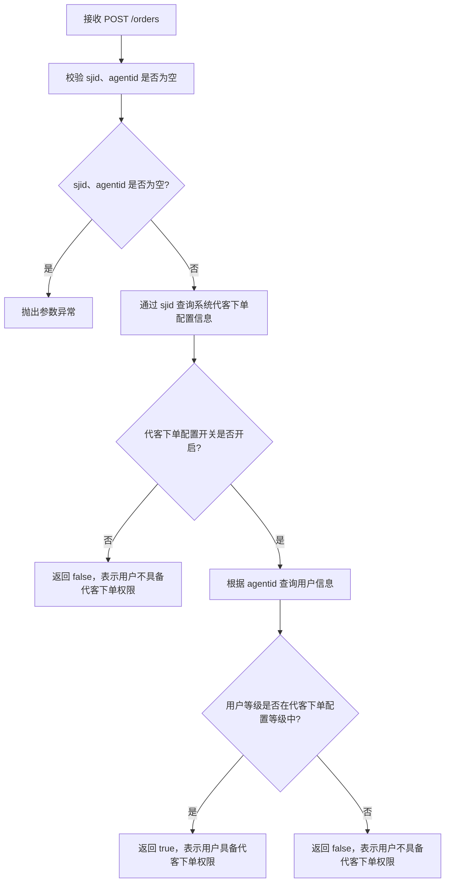
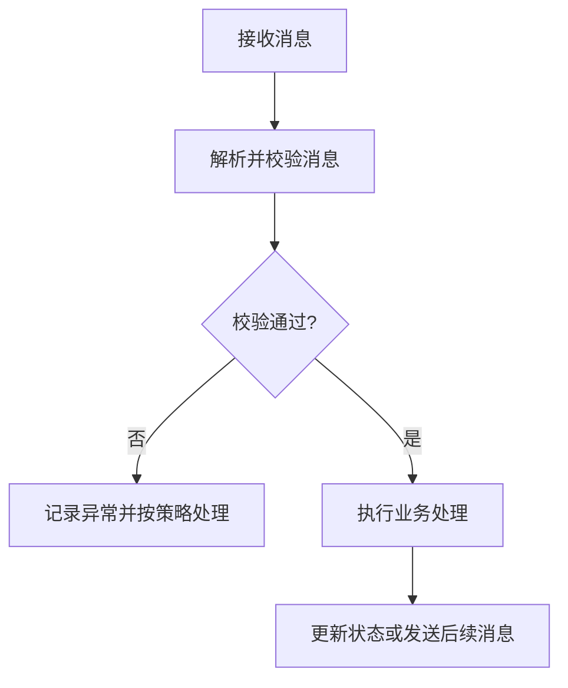
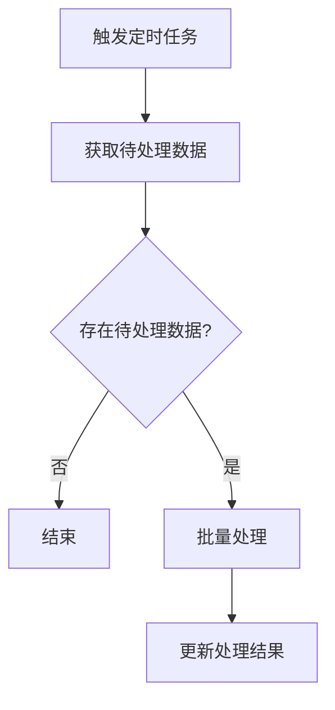
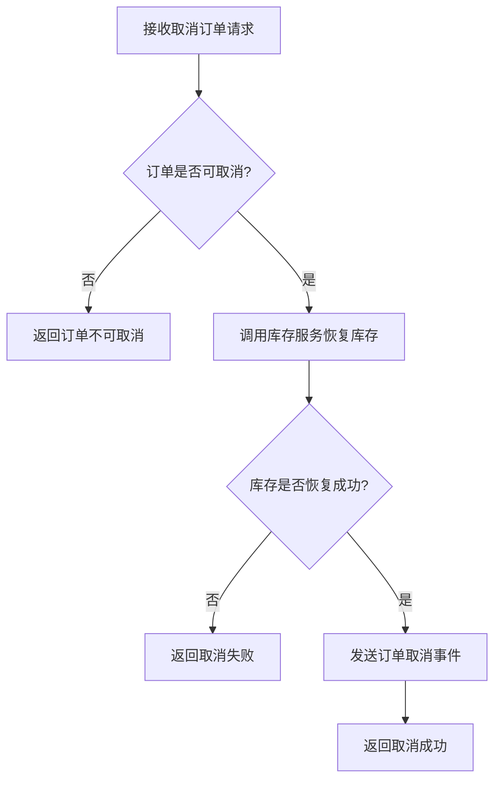
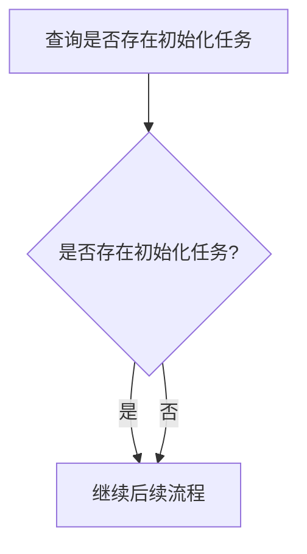
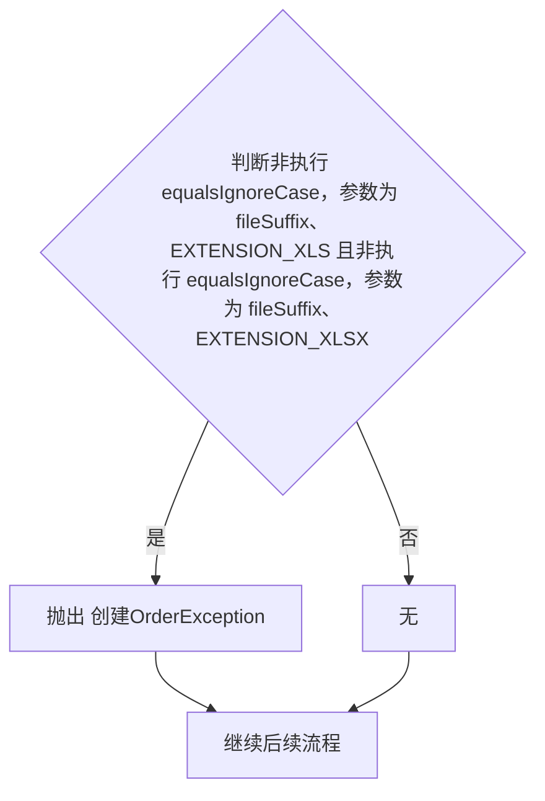
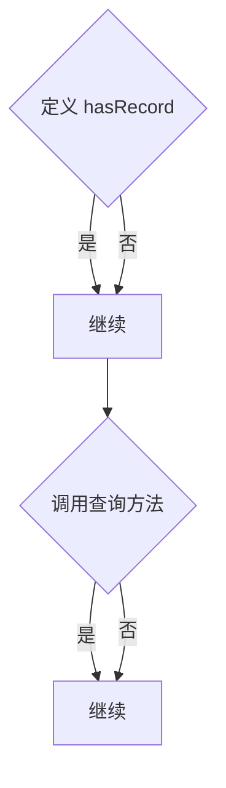
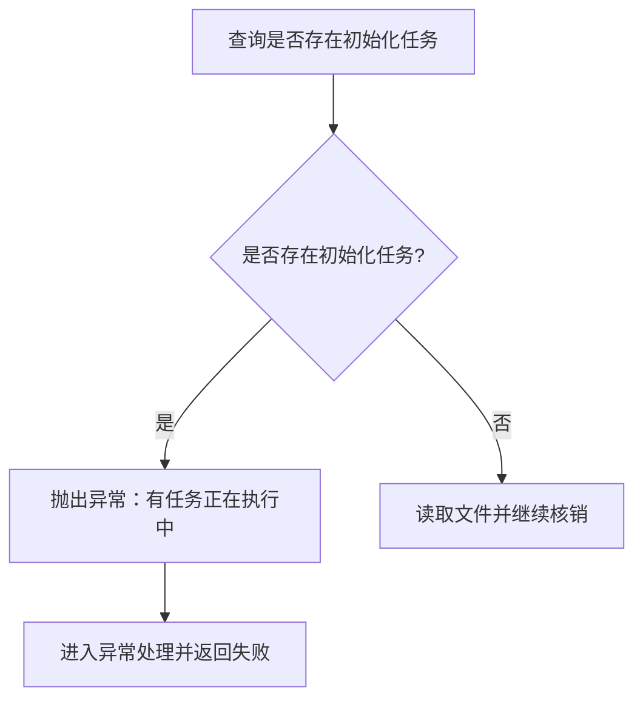
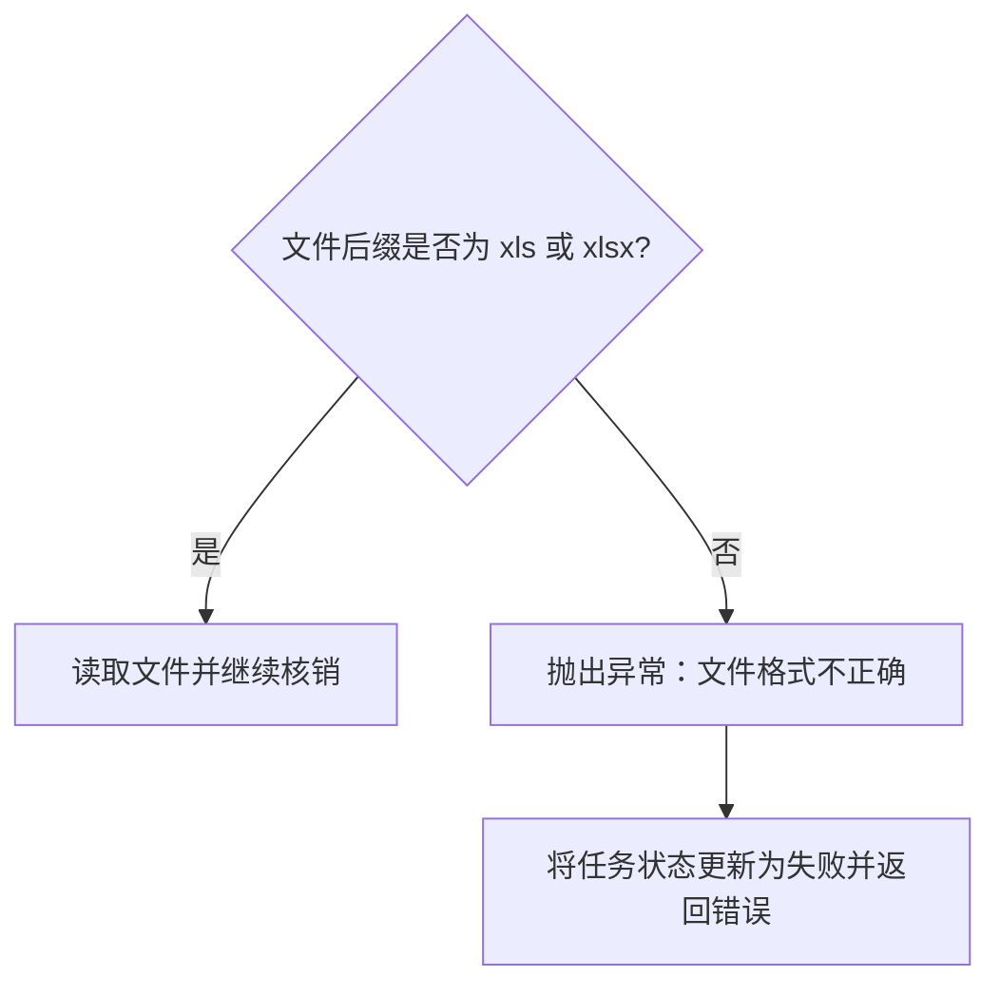

# 接口 Wiki Schema

本文件定义 `D:\liuyu\company\sesun\code\llm-wiki\my-llm-wiki` 的目录、字段、索引、日志和页面模板。初始化时将其复制为 `D:\liuyu\company\sesun\code\llm-wiki\my-llm-wiki\WIKI-SCHEMA.md`；

## 目录结构

```text
my-llm-wiki/
  index.md                         # 一级索引：只列服务
  WIKI-SCHEMA.md                   # 本项目采用的页面与维护约定
  services/
    <service-name>/
      index.md                     # 二级索引：只列类
      log.md                       # 服务级操作日志，只追加
      controllers/
        <ClassName>/
          index.md                 # 三级索引：只列本类 Controller 方法
          log.md                   # 类级方法日志，按方法追加
          <method>-<line>.md
      consumers/
        <ClassName>/
          index.md                 # 三级索引：只列本类 Consumer/listener 方法
          log.md                   # 类级方法日志，按方法追加
          <method>-<line>.md
      schedulers/
        <ClassName>/
          index.md                 # 三级索引：只列本类定时任务方法
          log.md                   # 类级方法日志，按方法追加
          <method>-<line>.md
      synthesis/
        <topic>.md
```

仅在存在对应类型的入口方法时创建类型目录；仅在类存在入口页面时创建类目录。类目录中的 `index.md` 是该类方法的三级索引，`log.md` 是该类的方法级操作日志。`synthesis` 用于沉淀跨接口、跨服务或调用链分析。

如需让后续代码 agent 默认查询 Wiki，必须在用户明确要求后，才在项目根 `AGENTS.md` 增加简短入口说明；不要自动修改项目级 agent 配置。

## 命名规范

### 目录与文件

- 类目录名必须与源码类名完全一致，例如 `OrderController/`。
- 入口页面统一为 `<method>-<line>.md`，例如 `create-42.md`；同一个类的方法页面全部放在该类目录中。
- `line` 是该入口方法声明的源码起始行号，使用十进制数字，不带 `L` 前缀；源码行号变化时必须同步重命名页面。
- `Controller` 页面位于 `controllers/<ClassName>/`，`Consumer` / listener 页面位于 `consumers/<ClassName>/`，定时任务页面位于 `schedulers/<ClassName>/`。
- 类目录内的 `index.md` 只列本类方法入口；服务目录内的 `index.md` 只列本服务类入口和合成页面。
- 合成页面使用描述主题的 kebab-case 文件名，例如 `order-lifecycle.md`。

### id

新页面使用全局唯一、可稳定映射的 id：

- 入口页面默认使用 `<service>.<ClassName>.<method>`，例如 `order-service.OrderController.create`。
- 同一类中存在同名重载方法时，冲突页面统一追加 `.L<line>`，例如 `order-service.OrderController.create.L42`；无冲突时不要主动追加行号。
- 合成页面使用 `<service>.synthesis.<topic>`。
- 服务名、类名和方法名保留原始大小写；服务名中的空格替换为 `-`。
- 既有 Wiki 使用短 id 时可以继续沿用，但不得再为新增页面创建短 id。发生重命名时，必须先更新全部引用并记录日志。

## 页面类型

`type` 只能使用以下值：

| type | 用途 |
|---|---|
| `controller` | HTTP / RPC 等 Controller 入口方法 |
| `consumer` | MQ、事件或其他消息监听方法 |
| `scheduler` | 定时任务或调度入口方法 |
| `synthesis` | 分析、对比、调用链或跨页面知识沉淀 |
| `class-index` | 类三级索引，只列本类入口方法 |
| `service-index` | 服务二级索引，只列本服务类入口和合成页面 |
| `root-index` | Wiki 一级索引，只列服务 |

## Frontmatter

入口页面和合成页面必须使用以下字段：

| 字段 | 必填 | 格式 | 说明 |
|---|---|---|---|
| `id` | 是 | 字符串 | 全局唯一页面 id |
| `service` | 是 | 字符串 | 所属服务名，与目录名一致 |
| `type` | 是 | 枚举值 | 页面类型 |
| `entry` | 是 | 字符串 | 入口标识；合成页面填写分析主题 |
| `source` | 是 | YAML 列表 | 来源位置列表；合成页面也需列出依据 |
| `tags` | 是 | YAML 列表 | 小写主题标签，可为空列表 |
| `related` | 是 | YAML 列表 | 相关页面 id，可为空列表 |
| `created` | 是 | `YYYY-MM-DD` | 首次创建日期 |
| `updated` | 是 | `YYYY-MM-DD` | 最近一次知识内容变更日期 |

`source` 使用项目根目录相对路径，并尽量带行号：

```yaml
source:
  - order-service/src/main/java/com/example/OrderController.java:42
  - order-service/src/main/java/com/example/CreateOrderService.java:88
```

入口页面 `source` 的第一条必须指向该页对应入口方法的声明行，且行号必须与页面文件名后缀和类索引一致。

只移动源码行号、不改变业务含义时，更新 `source`、重命名页面并同步类索引，不更新 `updated`。入口、业务规则、分支、异常或一致性语义发生变化时，必须更新 `updated`。

`related` 只写页面 id，不写文件路径。目标不存在时先修正 id 或留空，不保留无法解析的关联。

## 一级索引

`my-llm-wiki/index.md` 是第一级索引，只列服务，不列类、入口或业务细节，不放全局日志。

```markdown
# 接口 Wiki 索引

> 按服务导航到接口页面；查询优先从本索引开始。

| 服务 | 说明 | 二级索引 |
|---|---|---|
| order-service | 下单、取消、库存协同 | [services/order-service/index.md](services/order-service/index.md) |
| user-service | 用户注册、登录、资料 | [services/user-service/index.md](services/user-service/index.md) |
```

## 二级索引

`services/<service>/index.md` 是第二级索引，只列本服务的类和合成页面，按入口类型分节。类目录即使尚未建立，也不要提前加入服务索引。

```markdown
# order-service - 接口索引

服务说明：下单、取消、库存协同

源码根目录：`order-service/`

本服务日志：[log.md](log.md)

类级日志：每个类目录下的 `log.md`，按方法记录变更。

## Controllers

| 类 | 说明 | 方法数 | 类索引 |
|---|---|---:|---|
| OrderController | 订单创建和查询 | 12 | [controllers/OrderController/index.md](controllers/OrderController/index.md) |

## Consumers

| 类 | 说明 | 方法数 | 类索引 |
|---|---|---:|---|
| OrderEventConsumer | 订单事件消费 | 3 | [consumers/OrderEventConsumer/index.md](consumers/OrderEventConsumer/index.md) |

## Schedulers

| 类 | 说明 | 方法数 | 类索引 |
|---|---|---:|---|
| OrderCloseJob | 超时订单处理 | 1 | [schedulers/OrderCloseJob/index.md](schedulers/OrderCloseJob/index.md) |

## Synthesis

| 页面 | 主题 |
|---|---|
| [order-lifecycle.md](synthesis/order-lifecycle.md) | 订单从创建到完成的完整链路 |
```

服务说明应保持一到两句话；源码根目录使用项目根目录相对路径。`Synthesis` 不属于“服务-类-方法”入口导航链，但仍在服务索引中保留独立分节。

## 三级索引

`services/<service>/<type>/<ClassName>/index.md` 是第三级索引，只列本类入口方法，不承载业务流程或实现细节。Controller、Consumer 和 Scheduler 使用相同的列结构；路径前缀分别为 `controllers/`、`consumers/` 和 `schedulers/`。

```markdown
# OrderController - Controller 接口索引

服务：order-service

入口类型：Controller

源码：`order-service/src/main/java/com/example/OrderController.java`

上级索引：[../../index.md](../../index.md)

本类日志：[log.md](log.md)

## 方法

| id | 方法 | 行号 | 入口 | 说明 | 页面 |
|---|---|---:|---|---|---|
| order-service.OrderController.create | create | 42 | POST /orders | 创建订单 | [create-42.md](create-42.md) |
| order-service.OrderController.query | query | 86 | GET /orders/{id} | 查询订单 | [query-86.md](query-86.md) |
```

同名重载方法需要在 `id` 中追加 `.L<line>`，并在“方法”列直接使用源码方法名。方法页面的文件名后缀、类索引“行号”和页面 `source` 第一条的入口方法行号必须完全一致。

三级索引导航顺序固定为：根索引（服务）-> 服务索引（类）-> 类目录 `index.md`（方法）-> 方法页面。

## 日志规范

日志分为服务级和类级两层，均只追加记录，不编辑或删除历史条目。

### 服务级日志

每个服务根目录维护一个 `log.md`，只记录服务级、批量、跨类、迁移和全服务校验操作。涉及多个服务的操作，分别写入各服务的服务级日志。

```markdown
# order-service Wiki 操作日志

## [2026-10-16] migrate | 三级目录迁移
- 迁移入口页面：851
- 建立类目录：160
- 建立类索引：160
- 建立类日志：160
- 校验：页面 id 唯一，链接可解析
```

单方法更新不写服务级日志；批量操作可以只记录范围、数量和校验结果。

### 类级日志

每个存在入口页面的类目录维护一个 `log.md`，按方法粒度记录新增、更新、重命名、校验等操作。单方法变更必须写入所属类日志。

```markdown
# order-service.OrderController Wiki 操作日志

## [2026-10-16] update | OrderController.create

- 页面：`create-42.md`
- id：`order-service.OrderController.create`
- 变更：补充参数校验和异常路径
- 来源：`order-service/src/main/java/com/example/OrderController.java:42`
- 校验：业务规则与流程图已同步
```

类级日志记录操作事实，不复制业务规则或大段分析内容。

## 业务规则写作约定

用于所有入口页面的“业务规则”章节：

- 按源码实际执行顺序编号，使用中文业务动作、条件和结果。
- 禁止出现赋值语句、方法签名、字段访问式、Lambda、原始 SQL、日志调用等代码式表达；参数名可以使用反引号保留。
- 分支统一使用“为空/不为空、是/否、开启/关闭、成功/失败”等形式，并明确写出处理动作和最终结果。
- 同类私有方法、同类非私有方法以及源码可追踪的跨类普通业务方法必须按源码执行顺序展开；不得只写一句方法调用概括。
- Feign 接口调用和 MQ 发送或投递调用只写一句影响当前入口结果的业务语义概括，不递归展开被调用方内部实现。
- 展开普通业务方法时保留影响当前入口结果的业务动作、条件、异常、返回和结束路径；无法读取、调用目标不唯一或源码范围不足时标记“待确认”。
- 技术细节只在影响业务结果时说明；普通日志、对象复制、变量赋值等实现细节不写入“业务规则”。
- 禁止同义反复的赋值描述：不得出现「设置X为X」「设置X为获取X」这类字段名与取值同名的规则，大小写不同的同名字段赋值同样视为同义反复。
- 字段赋值只有在能写明取值来源与接收方字段时才写入业务规则，例如「将请求头中的 sjid 写入 param 的 sjid 字段」；同名取值、对象复制或来源无法确认时，该赋值不写入业务规则，也不绘制对应的流程图节点。
- 源码无法确认业务含义时写“待确认”，禁止根据名称猜测。
- 流程图必须从定稿后的“业务规则”逐条生成，两者一一对应；业务规则供人和 AI Agent 阅读，流程图供人阅读。
- 业务规则变更后必须同步重绘流程图，不得只修改文字规则而保留旧的概括流程图。
- 生成流程图前必须先建立控制流骨架：记录动作、真实条件及其两个出口、异常抛出点、对应 `catch`、返回点和结束点；控制流骨架与业务规则核对后再绘图。

## 入口页面模板

以下示例中，Controller 页面位于 `controllers/OrderController/create-42.md`，Consumer 页面位于 `consumers/OrderEventConsumer/onOrderCreated-35.md`，Scheduler 页面位于 `schedulers/OrderCloseJob/closeExpired-28.md`。每个示例都必须同时存在于对应类目录的 `index.md` 中。

### Controller

````markdown
---
id: order-service.OrderController.create
service: order-service
type: controller
entry: POST /orders
source:
  - order-service/src/main/java/com/example/OrderController.java:42
tags: [order, create]
related: [order-service.OrderEventConsumer.onOrderCreated]
created: 2026-10-15
updated: 2026-10-15
---

# OrderController.create

## 做什么

一句话说明接口职责和使用场景。

## 入口与契约

- 请求：`POST /orders`
- Content-Type：`application/json`
- 入参：逐个字段说明类型、必填性、格式、范围、默认值和校验失败结果
- 返回：成功结构、业务错误码和异常返回

## 业务规则

按上述“业务规则写作约定”编写，完整覆盖主流程、全部分支、数据查询和变更、外部调用、事务、幂等和状态流转。

1. 校验请求参数。
   - sjid、agentid 为空：抛出参数异常。
   - sjid、agentid 不为空：通过 sjid 查询系统代客下单配置信息。
2. 判断代客下单配置开关状态。
   - 关闭：接口返回 false，表示用户不具备代客下单权限。
   - 开启：根据 agentid 查询用户信息。
3. 判断用户等级是否在代客下单配置等级中。
   - 是：接口返回 true，表示用户具备代客下单权限。
   - 否：接口返回 false，表示用户不具备代客下单权限。


## 流程图



## 未确认

仅列出源码不足以确认的事项；没有时删除本节。

- 待确认：外部服务失败后的补偿行为，源码中未体现。

## See Also

- [[order-service.OrderEventConsumer.onOrderCreated]] — 订单创建后的消费者
````

### Consumer

````markdown
---
id: order-service.OrderEventConsumer.onOrderCreated
service: order-service
type: consumer
entry: topic: order.created
source:
  - order-service/src/main/java/com/example/OrderEventConsumer.java:35
tags: [order, mq]
related: [order-service.OrderController.create]
created: 2026-10-15
updated: 2026-10-15
---

# OrderEventConsumer.onOrderCreated

## 做什么

一句话说明消息消费目的。

## 触发条件

- Broker / 交换机：
- Topic / Queue：
- Routing key：
- 消息体或事件类型：
- 并发、顺序和消费组：

## 业务规则

按上述“业务规则写作约定”编写，覆盖收到消息后的全部校验、分支、业务流程、异常和状态流转。

## 流程图



## 未确认

仅列出源码不足以确认的事项；没有时删除本节。

## See Also

- [[order-service.OrderController.create]] — 上游入口
````

### Scheduler

````markdown
---
id: order-service.OrderCloseJob.closeExpired
service: order-service
type: scheduler
entry: 每 5 分钟执行
source:
  - order-service/src/main/java/com/example/OrderCloseJob.java:28
tags: [order, scheduler]
related: []
created: 2026-10-15
updated: 2026-10-15
---

# OrderCloseJob.closeExpired

## 做什么

一句话说明定时任务目的。

## 调度配置

- Cron / fixedRate / fixedDelay：
- 首次执行时间和时区：
- 单实例或集群执行：
- 超时和重叠策略：

## 业务规则

按上述“业务规则写作约定”编写，说明触发后的扫描范围、分批策略、单条处理、业务流程、失败隔离和最终状态。

## 流程图



## 未确认

仅列出源码不足以确认的事项；没有时删除本节。

## See Also

- [[order-service.OrderController.create]] — 相关业务入口
````

### Synthesis

````markdown
---
id: order-service.synthesis.order-lifecycle
service: order-service
type: synthesis
entry: 订单完整生命周期
source:
  - my-llm-wiki/services/order-service/controllers/OrderController/create-42.md
  - my-llm-wiki/services/order-service/consumers/OrderEventConsumer/onOrderCreated-35.md
tags: [order, lifecycle]
related: [order-service.OrderController.create]
created: 2026-10-15
updated: 2026-10-15
---

# 订单完整生命周期

## 问题

说明本次沉淀要回答的问题。

## 结论

给出可执行、可验证的结论。

## 依据

逐条列出页面 id、源码位置和事实关系，不把推测写成结论。

## 未知与风险

列出尚未确认的边界、冲突或后续验证项。

## See Also

- [[order-service.OrderController.create]]
````

## Mermaid 约定

### 节点与控制流

- 使用 ` ```mermaid ` 代码块和 `flowchart TD`。
- 动作节点使用矩形 `A["动作"]`，表示初始化、查询、保存、状态设置、外部调用、返回结果等实际业务动作。
- 判断节点使用菱形 `A{"条件?"}`，只能表示源码中真实改变执行路径的条件，例如 `if/else`、循环条件、三元表达式和会短路后续动作的条件。
- 变量定义、字段赋值、数据查询、参数组装以及 Feign/MQ 调用都不能单独作为判断节点；它们只能作为动作节点。
- 同类私有方法、同类非私有方法和源码可追踪的跨类普通业务方法必须展开为有明确规则和分支的子流程，不得只画一个方法调用动作节点；子流程内部条件、异常、返回和结束路径必须完整。
- Feign 接口调用和 MQ 发送或投递调用只保留一个动作节点，不得把被调用方内部判断、异常和返回路径绘制进当前流程图。
- 每个判断节点必须能还原为“若条件成立，则走 A；否则走 B”。两个出口必须对应不同动作、不同子流程或不同终态；禁止两个出口直接汇聚到同一个节点，或汇聚到没有业务差异的节点。
- 如果两个出口最终会合并，合并点必须位于各自分支动作之后，不能放在分支动作之前。
- 节点 id 使用英文字母和数字，节点文本使用中文并包裹双引号，例如 `A["校验参数"]`。
- 分支标签使用 `-->|"是"|` 和 `-->|"否"|`；条件不同但语义等价时，优先改写成一句业务问题，避免双重否定和重复判断。
- 判断节点文本必须是业务问题，不得直接写方法名、常量名、参数名或源码表达式；例如应将 `!equalsIgnoreCase(fileSuffix, XLS) && !equalsIgnoreCase(fileSuffix, XLSX)` 翻译成“文件后缀是否为 xls 或 xlsx?”。
- 禁止创建“无”“继续”“继续后续流程”等只用于承接边或汇合分支的占位节点。分支结束后应直接连接真实下一步；没有真实下一步时，直接连接真实返回、结束或错误结果。

### 分支结构

- `if` 只有成立分支有动作时：条件成立进入动作，再到达真实合并点；条件不成立直接到达同一合并点。不得在成立分支动作之前添加一个让两个出口先共同“继续”的节点。
- `if/else`：条件成立进入成立分支动作，不成立进入不成立分支动作，两个分支动作结束后才可在真实合并点汇合。
- 多个经过 `&&` 或 `||` 的条件只有在表达同一个业务判断且结果一致时，才可合并为一个业务问题；如果短路顺序、异常结果或后续动作不同，必须分别绘制判断路径。
- 循环：判断节点成立进入循环体并回到判断节点，不成立进入循环后的真实下一步；不得把循环体调用画成循环条件。
- 一个条件如果两个出口最终没有不同动作、不同状态或不同终态，就不是有效业务分支；应删除该判断节点或回到源码确认遗漏了哪个处理结果。

### 调用展开示例

“判断订单是否可取消”来自同类私有方法或源码可追踪的跨类普通业务方法时必须展开其判断，不能只画一个“调用取消校验方法”节点。库存恢复属于 Feign 接口调用，只保留一个动作节点；发送取消事件属于 MQ 调用，也只保留一个动作节点。

业务规则示例：

1. 判断订单是否可取消。
   - 否：返回订单不可取消。
   - 是：调用库存服务的 Feign 接口恢复库存。
2. 判断库存是否恢复成功。
   - 否：返回取消失败。
   - 是：发送订单取消事件。
3. 返回取消成功。



### 异常与结束路径

- `try` 正常路径按源码继续；抛出异常后必须进入最接近的匹配 `catch`，不得进入异常发生位置之后的正常业务步骤。
- `catch` 中重新抛出异常时，该路径进入入口错误返回或最终错误结果；未重新抛出时才可按源码继续 `catch` 之后的流程。
- `finally` 存在时，正常路径和异常路径都必须经过 `finally`，之后按源码分别返回、继续或终止。
- 返回、结束和未被捕获的异常是终态节点，不得再有正常后续边；抛出异常节点只能连接到对应 `catch`、入口错误返回或最终错误结果。
- 异常处理中的状态更新、备注设置、日志记录等动作只有影响当前入口结果时才绘制；绘制时必须位于对应异常路径上。
- 抛出异常的分支不得与正常分支共同汇入“继续后续流程”等占位节点；异常路径与正常路径只能在实际的 `catch`、错误返回或最终结果处按源码关系处理。

### 常见错误与正确示例

以下写法错误：两个出口汇聚到同一个“继续后续流程”节点，条件没有改变任何业务结果。



以下写法错误：判断节点使用源码方法名，正常分支创建了“无”占位节点，异常分支又接回“继续后续流程”。



这里的三个问题分别是：判断文本不可读、无动作分支被画成“无”节点、异常路径错误地接回正常流程。

以下写法同样错误：变量定义、查询调用和真正的条件判断被分别画成三个菱形，形成无意义分支。



正确写法应按源码区分存在和不存在两种结果，并让异常路径终止正常流程：



文件后缀校验也应使用业务问题，并直接连接真实下一步或异常处理：



### 一致性要求

- 流程图必须以定稿后的“业务规则”为输入逐条生成，不得对业务规则重新概括、合并或省略。
- 每个编号业务规则必须映射为流程图中的节点、判断节点或子流程。
- 每个条件项必须映射为判断节点及对应出口路径，包括“为空/不为空、是/否、成功/失败、超过/未超过、存在/不存在”等分支。
- 每个初始化、查询、保存、跳过、异常、状态设置和返回结果都必须出现在流程图中。
- 不得使用“初始化查询范围”“校验权限”等笼统节点代替业务规则中的多个明确业务动作。
- 图只描述代码中真实存在的路径，不补画猜测路径；未知分支放入“未确认”。
- 业务规则与流程图不一致时，以业务规则为事实清单重新绘制流程图；复杂入口仍必须完整覆盖当前页面的全部业务规则。
- 调用展开粒度必须一致：同类私有方法、同类非私有方法和源码可追踪的跨类普通业务方法不得只写一句概括或只画一个调用节点；Feign 接口调用与 MQ 发送或投递调用不得展开为被调用方内部流程。

## 校验清单

结构校验：

- 根索引中的每个服务都有服务目录和二级索引。
- 服务索引只列类，不逐方法平铺；每个类入口都能解析到 `controllers/`、`consumers/` 或 `schedulers/` 下的类目录 `index.md`。
- 每个存在入口页面的类目录都有三级索引 `index.md` 和类级日志 `log.md`，且类目录名与源码类名完全一致。
- 三级索引中的每个方法页面都存在，且所有入口页面都恰好出现在所属类目录的三级索引中。
- 页面文件名严格使用 `<method>-<line>.md`，`line` 与入口方法声明行、三级索引“行号”和页面 `source` 第一条的行号一致。
- 页面位于与入口类型匹配的类型目录和类目录中，不直接平铺在类型目录下。
- `id` 全局唯一；同名重载方法的 `id` 使用 `.L<line>` 区分，`related` 指向存在的页面。
- frontmatter 字段完整，日期格式正确。
- `source` 路径存在，第一条指向当前页面入口方法声明行。
- Wiki 内部链接使用相对路径且可解析，类目录中的上级索引链接指向服务索引。
- 同一入口没有重复页面。
- 入口方法行号变化时，页面文件、三级索引、`source` 和所有引用已同步更新。
- 服务级日志只记录服务级、批量、跨类、迁移和全服务校验，只追加，不在普通查询中修改。

内容校验：

- 业务规则覆盖全部分支，而不是只写主流程。
- 流程图与业务规则一一对应，每个编号项、条件分支、跳过处理、异常和返回结果都有对应节点或路径。
- 流程图中的每个判断节点都由真实控制流条件产生；变量定义、字段赋值、普通方法调用和查询动作没有被画成判断节点。
- 每个判断节点的两个出口对应不同动作或不同终态；不存在两个出口直接到同一节点、同一个无业务差异节点或“是/否都继续”的分支。
- 异常、返回和结束节点没有接回正常后续流程；每个异常抛出点都已映射到对应 `catch`、入口错误返回或最终错误结果，`try/catch/finally` 路径与源码一致。
- 流程图反向朗读通过：每个菱形节点都可读成明确的“若条件成立则执行什么，否则执行什么”，不存在重复定义、重复调用、重复异常、无意义汇聚点或异常后继续。
- 判断节点文本使用业务语言，不出现方法名、常量名、参数名、源码表达式或“执行/调用/定义”等实现描述。
- 流程图中不存在“无”“继续”“继续后续流程”等仅用于承接或汇合的占位节点；分支结束位置连接的是真实业务动作、判断、返回、结束或错误结果。
- 流程图不得使用笼统节点替代业务规则中的多个明确动作，不得省略任何分支出口。
- 业务规则以中文业务动作和分支结果为主，不出现赋值、方法签名、字段访问、Lambda、原始 SQL 或日志调用。
- 业务规则中不存在「设置X为X」「设置X为获取X」等同义反复描述，也不存在丢弃赋值后残留的「xxx.」片段。
- 条件分支必须明确写出条件和处理结果，不得只罗列方法调用。
- 同类私有方法、同类非私有方法和源码可追踪的跨类普通业务方法已展开业务步骤和控制流，未用方法调用节点替代。
- Feign 接口调用和 MQ 发送或投递调用只保留一句业务概括和一个动作节点，未复制被调用方内部实现。
- 调用展开粒度与业务规则一致：普通业务方法未被概括为一句，Feign/MQ 调用未被展开为内部流程。
- 源码中无法确认的内容标为“待确认”，没有编造外部服务行为。
- 更新页面时同步更新类索引、类日志，并按变更范围同步服务索引和服务级日志。